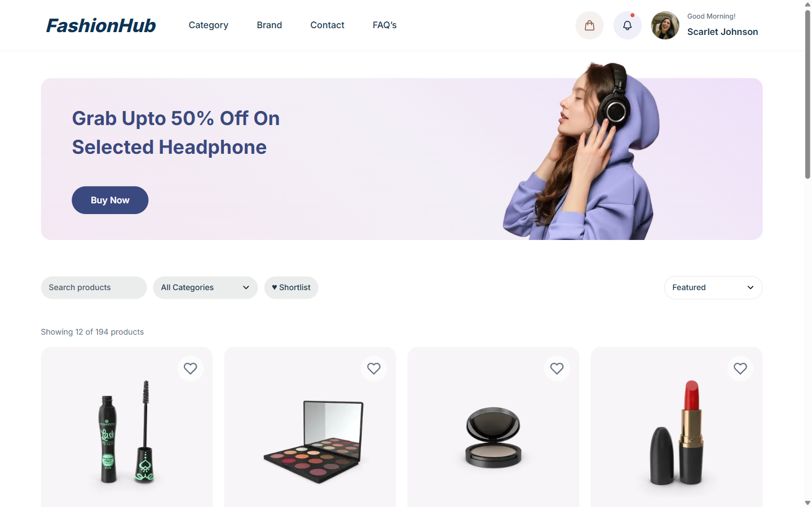
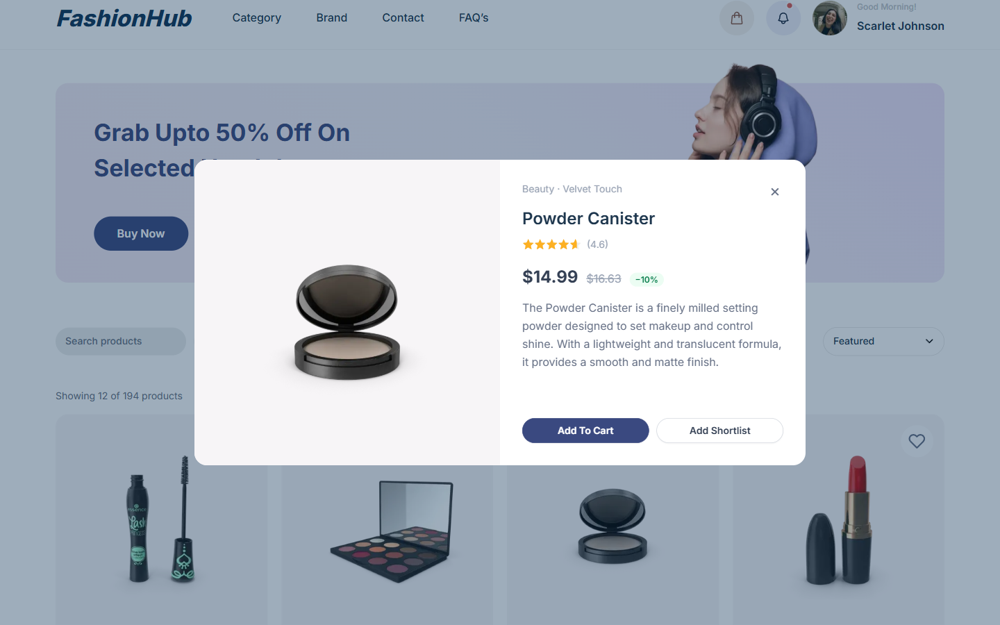
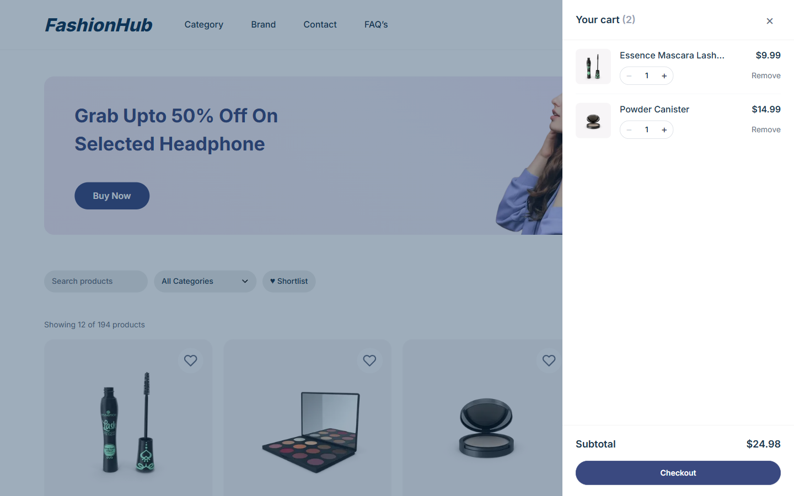
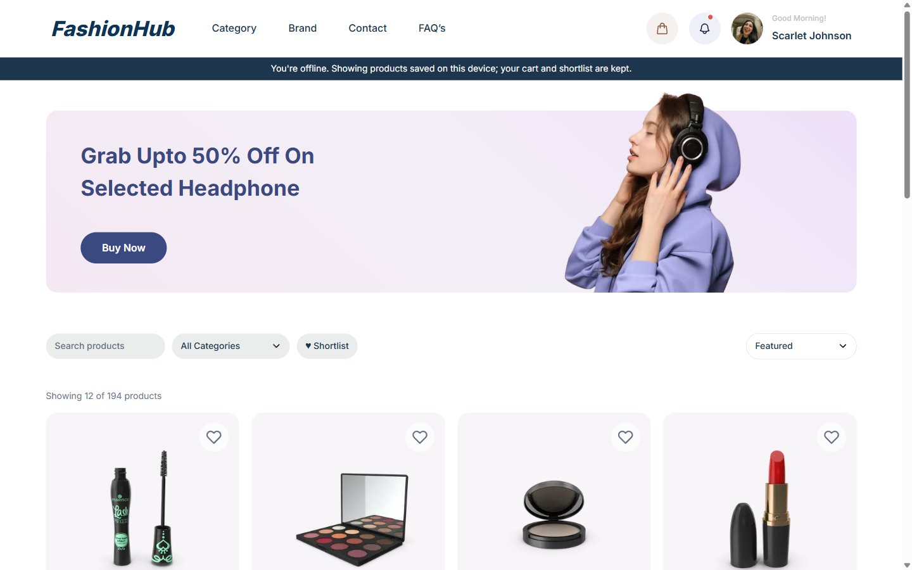
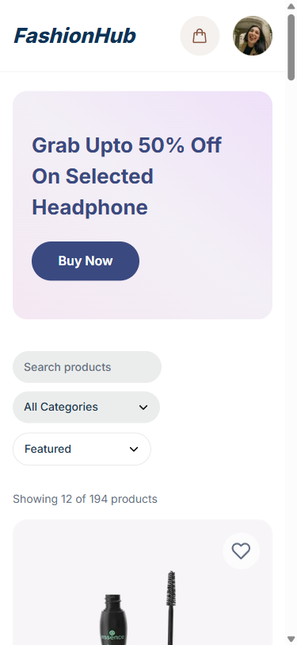

# FashionHub – Product Listing (Figma → Next.js)

A Figma e-commerce design turned into a responsive Next.js + Tailwind page, wired to a live product API, with a working cart and offline support.

**Live demo:** _coming soon_



| Quick view | Cart | Offline |
| --- | --- | --- |
|  |  |  |



## What I built

**From the design**
- Matched the Figma "Product List Page" frame: header, promo banner, filter pills, product cards, pagination.
- Responsive from 375px phones to 1440px desktops (1 to 4 columns).

**Data**
- Loads ~200 products from [DummyJSON](https://dummyjson.com) in one request; search, category, sort, a shortlist filter and pagination all run in the browser.
- Card-shaped loading skeletons, an empty state with "Clear filters", and an error state with "Try again" (requests time out after 10 s).
- Filters, sort and page live in the URL, so refresh, Back/Forward and shared links keep the view.

**Interactions**
- Hover: cards lift, images zoom, and the design's "Quick View" pill appears (also on keyboard focus).
- Quick View dialog with full description, discount and stock status.
- Cart drawer with quantity steppers, Remove with **Undo**, subtotal and a demo checkout.
- "Buy Now" jumps to the headphones category.

**Button states**
- Add To Cart: idle → *Adding…* (spinner) → *✓ Added* → idle; disabled as *Out of stock* or *Max in cart*.
- Shortlist toggles (heart and button share state, with `aria-pressed`).
- Checkout: *Placing order…* → confirmation; disabled as *Go online to check out* while offline.
- Pagination and quantity buttons disable at their limits.

**Offline**
- A service worker ([`public/sw.js`](public/sw.js)) keeps the page, product data and viewed images. Once you have visited, the store reloads with no connection.
- Product data is network-first (fresh when online, saved copy when not); scripts and images are cache-first.
- Cart and shortlist are saved on the device, so they survive reloads and offline sessions.
- An offline banner appears when the connection drops, and data refreshes on reconnect.
- Installable as an app (web manifest, icons, `theme-color`); the installed app opens offline.

**Accessibility (WCAG 2.2 AA)**
- 0 axe violations across every state; full results in [docs/ui-standards-report.md](docs/ui-standards-report.md).
- Native `<dialog>` (focus trap, Esc to close, focus returns to the card), skip link, labelled controls, visible focus rings, screen-reader text for cart count and ratings, 44px touch targets on phones, reduced-motion support.
- The design's light greys failed contrast (2.6:1), so text uses the kit's darker grey (4.8:1).

**Sharing**
- Social preview image, custom favicon and app icons; friendly error page if anything crashes.

## Stack

Next.js 15 (App Router) · React 19 · TypeScript · Tailwind CSS 4 · `next/image` · Service Worker + Cache Storage. No extra libraries.

## How the code is organised

The page only wires things together; behaviour lives in small modules with simple interfaces.

| Folder | What's in it |
| --- | --- |
| [`src/app/`](src/app) | Route files only: page, layout (skip link, metadata), error page, manifest, icons |
| [`src/lib/catalog.ts`](src/lib/catalog.ts) | Pure browsing rules: URL ↔ view, filter/sort/paginate. Tested in [`catalog.test.ts`](src/lib/catalog.test.ts) |
| [`src/hooks/`](src/hooks) | `useProducts` (fetch, retry, timeout), `useUrlView` (URL sync), `useCart`, `useShortlist`, `useOnline`, `useStoredState`, `useServiceWorker` |
| [`src/components/ui/`](src/components/ui) | Reusable primitives: Dialog, Select, Spinner, FadeImage, StateMessage |
| [`src/components/products/`](src/components/products) | Card, actions (button states), Quick View, toolbar, pagination, skeleton |
| [`src/components/cart/`](src/components/cart) | Cart drawer with Undo |
| [`src/components/layout/`](src/components/layout) | Header, banner, footer |
| [`src/app/globals.css`](src/app/globals.css) | Design tokens (`text-ink`, `bg-brand`, …) and shared button/pill styles |
| [`public/sw.js`](public/sw.js) | Offline caching |

## Run it

```bash
npm install
npm run build
npm start
```

Tests (Node's built-in runner, no extra packages):

```bash
npm test
```

Open http://localhost:3000. The service worker only runs in a production build. To try offline mode, load the page once, then switch DevTools → Network to **Offline** and reload.

## Credits

- Design: [Single Product & Product List Page](https://www.figma.com/community/file/1206898292713093171/single-product-product-list-page) by Kirit Goti, licensed [CC BY 4.0](https://creativecommons.org/licenses/by/4.0/). Changes: the static design was made interactive, prices show in USD, the footer placeholder became a credits footer, and the filter pills became search, category, shortlist and sort controls.
- Product data and images: [DummyJSON](https://dummyjson.com).

Built by [Ian Quilatan](https://github.com/ianquilatanwe), available for small frontend jobs [on Upwork](https://www.upwork.com/freelancers/~011c7ba66b3e0501a5).
